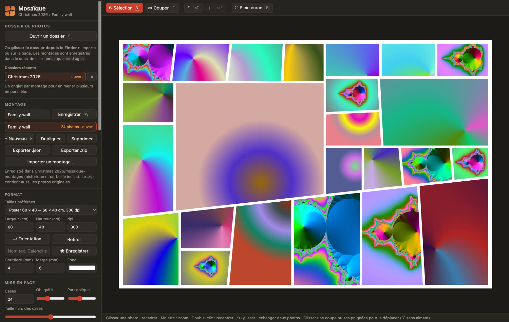
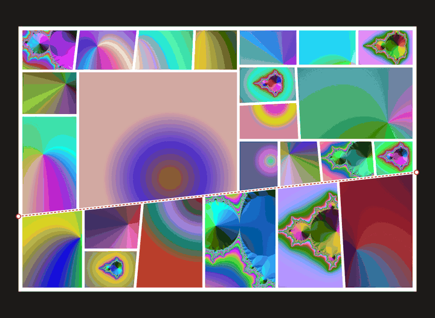
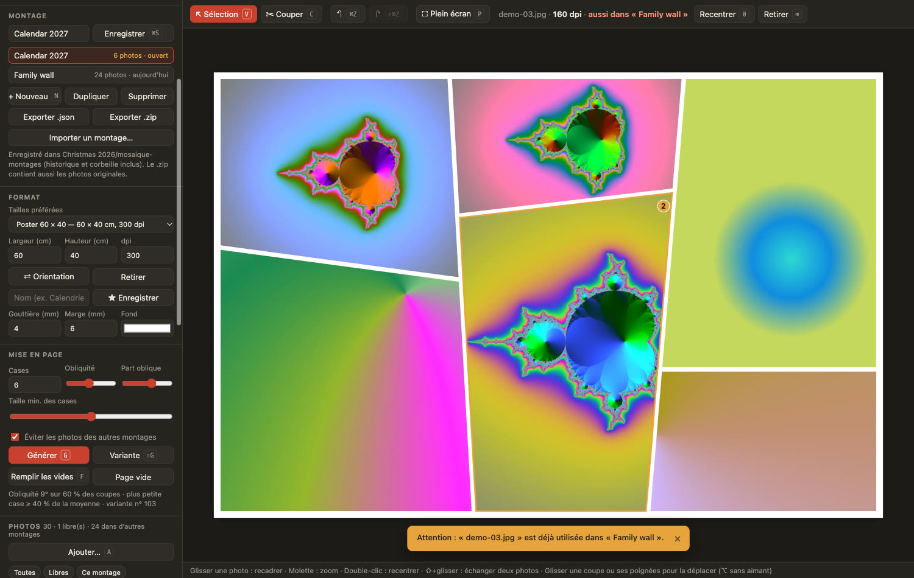
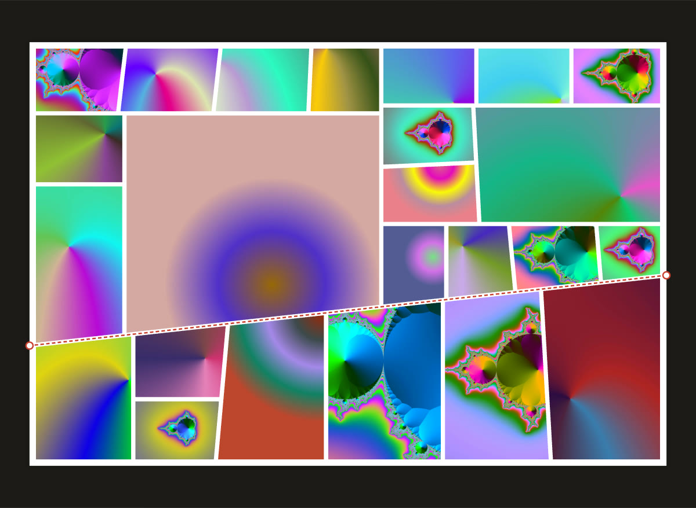
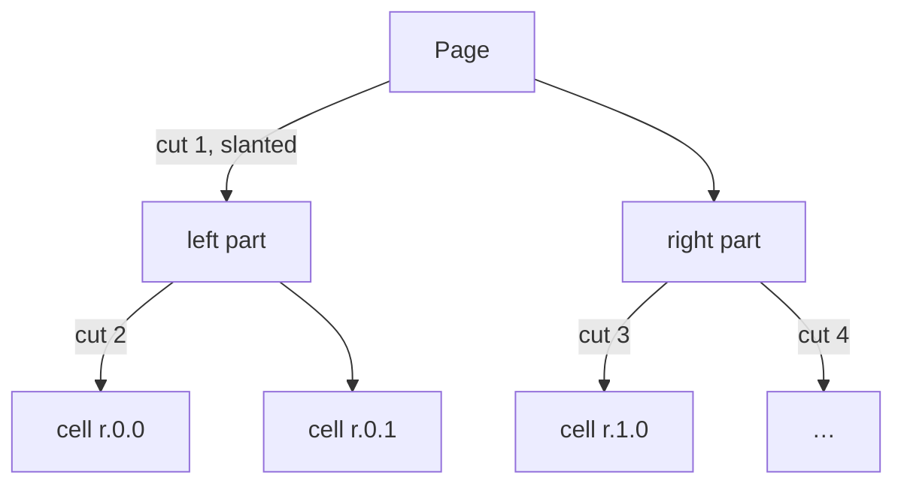

<div align="center">

# Mosaïque

**Photo collages with slanted cuts, without spending hours in Illustrator.**

A small local web app to lay out dozens of photos in polygonal cells separated by a clean, even gutter,
then export a print-ready file.

[](LICENSE)


### [▶ Try it online: tomy137.github.io/mosaique](https://tomy137.github.io/mosaique/)



</div>

> The user interface is in French 🇫🇷. Everything runs in your browser: photos never leave your computer.

## Why

Every Christmas I make a big family photo collage: 30 to 60 pictures, straight and slanted cells, a white gutter between them.
In Illustrator, each cell is an independent clipping path. Moving one border means editing every neighbouring path by hand,
then re-cropping every photo. It takes hours.

Mosaïque models the layout the way it actually is: **a page cut into pieces by lines**. Move a line and every cell that touches it follows.

<div align="center">
  
  <br><sub>Drag a cut: the cells on both sides reshape, and the cuts that end on it stretch to follow.</sub>
</div>

## Features

**Layout**
- ✂️ **Cuts that stay linked**: straight or slanted, they end on other cuts (T-junctions) and keep following them.
- 🎛️ **Direct editing**: drag a cut to move it, drag its handles to rotate it (snaps to horizontal/vertical), click to split a cell, straighten or delete a cut.
- 🪄 **Automatic layout**: one cell per photo, each cell close to its photo's aspect ratio, with adjustable slant, share of slanted cuts and a **minimum cell size** (no more tiny cells).
- 🌀 **Pinwheel layout**: four blocks turn around a central one, so that **no line runs across the whole page**, the way collages are often made by hand. Pick *Moulinet*, *Classique* or *Au hasard* before generating.
- 📐 **Even gutter and margin**, background colour, any page size in cm + dpi, and **favourite sizes** for the formats you print again and again.

**Photos**
- 🖼️ Drag & drop from the library, **crop by dragging, zoom with the wheel**, swap two photos with ⇧ + drag.
- 🔴 Warning badge when a photo would print under 150 dpi.
- 🟠 **"Already used" badge**: a folder is your photo selection, and it can hold several collages. Photos placed in another collage are flagged on the cell and in the library, and the generator avoids them by default.

**Photo books**
- 📖 **Albums**: a cover and as many pages as you need, each page laid out like a collage. A page strip groups the pages into spreads (cover alone, page 1 on the right, then 2-3, 4-5…); drag to reorder, add, duplicate or delete pages, `[` / `]` to turn them.
- 📅 **Chronological fill**: photos are sorted by capture date (EXIF) and spread over a range of pages, breaking at the biggest time gaps (a new day, a new moment), with a minimum and maximum number of photos per page. Every page is then laid out automatically, and stays editable.
- ▯▯ **Spread view**: the facing page is shown next to the one you edit, with the fold, so you judge the double page as it will look in the book. Click it to edit it.
- ✂️ **Bleed and safety zone**: set the bleed your printing service asks for (3 mm by default); with a 0 margin, photos run to the edge of the bleed. The trim line and the safety zone are drawn on the page.
- 🖨️ **Print-ready album**: one multi-page PDF at the exact sheet size (bleed included), or a `.zip` with one JPEG per page.
- 🔁 Photos already used on another page are flagged (« p. 4 »), and generating a page avoids them.

**Text**
- 🔤 **Titles, dates and captions** (`T`): text boxes on top of the layout, edited in place with a double-click, moved and resized with the mouse, with size, bold, alignment, colour and an optional dark band behind them. In collages too.

**Files & safety**
- 💾 **Several collages per folder**, auto-saved next to the photos, with a dated **history** and a **trash** folder. Nothing is ever overwritten.
- 📦 **Export / import** a collage as `.json`, or as a `.zip` that bundles the original photos, to move it to another computer.
- 🖨️ **Print export**: JPEG, PNG or PDF at full resolution (e.g. 60 × 40 cm at 300 dpi = 7087 × 4725 px), a light JPEG for screens, or the bare cell outlines as SVG for Illustrator.
- ⛶ **Full screen** view of the collage alone.
- 📏 **Rulers in centimetres** along the top and left of the collage, following zoom and scroll.
- 🟣 **Duplicate warning**: a « ×2 » badge when the same photo appears twice in one collage.
- 🗂️ **Two panels**: settings on the left in collapsible sections (with a one-line summary when folded), photos on the right in a resizable panel with adjustable thumbnail size. Each panel hides with one key.

<table>
  <tr>
    <td width="50%"></td>
    <td width="50%"></td>
  </tr>
  <tr>
    <td align="center"><sub>Several collages in one folder; the orange badge marks a photo already used in “Family wall”.</sub></td>
    <td align="center"><sub>A selected cut and its handles.</sub></td>
  </tr>
</table>

## Quick start

**Online**: open **[tomy137.github.io/mosaique](https://tomy137.github.io/mosaique/)** in Google Chrome (or another Chromium browser) and drag a folder of photos onto the page. Nothing to install, and your photos stay on your computer.

**Locally** (needs Node.js 20+), which also gives the HEIC helper the folder's full path:

```bash
git clone https://github.com/tomy137/mosaique.git
cd mosaique
npm install
npm run dev        # → http://localhost:5173
```

Then **drag a folder of photos from Finder / Explorer onto the page**. Mosaïque loads the photos and generates a first collage right away.

1. Press **G** for another layout, **⇧G** for a variant with the same settings.
2. Adjust: move cuts, crop photos, press **C** to add cuts.
3. Press **E** to export a print-ready JPEG, or use the PDF / PNG buttons.

## Keyboard shortcuts

| Key | Action | Key | Action |
|---|---|---|---|
| `V` | Select / move mode | `C` | Cut mode |
| `G` / `⇧G` | Generate a layout / variant | `F` | Fill empty cells |
| `R` | Straighten the selected cut | `⌫` | Delete cut / remove photo |
| `0` | Reset the photo's crop | `P` | Full screen (`Esc` to leave) |
| `N` | New collage | `⌘S` | Save, with a copy in the history |
| `M` | Show / hide the settings panel | `B` | Show / hide the photos panel |
| `Tab` | Hide / show both panels | `⇧R` | Show / hide the cm rulers |
| `⌘Z` / `⇧⌘Z` | Undo / redo | `O` · `A` · `E` | Open folder · add photos · export JPEG |
| `T` | Add a text (double-click or `↵` to edit it) | `[` / `]` | Previous / next album page (also `Page ↑` / `Page ↓`) |
| `D` | Album: show / hide the facing page | | |

In cut mode, hold `⇧` to force horizontal/vertical and `⌥` to disable snapping.

**View** (handy for wide or tall formats): `⌘` + wheel or trackpad pinch to zoom around the pointer, `Space` + drag (or middle-click drag) to move around, `⇧` + wheel to scroll, `+` / `−` to zoom, `⇧1` to see the whole page again. The plain wheel over a photo still zooms the photo itself.

## Where things are saved

Collages live next to your photos, in a plain JSON format:

```text
Christmas 2026/
├── IMG_0001.jpg
├── IMG_0002.jpg
├── …
└── mosaique-montages/
    ├── Family wall.json        ← one file per collage
    ├── Calendar 2027.json
    ├── Album 2026.json         ← an album: all its pages in one file
    ├── .historique/            ← dated copies (last 30 per collage)
    └── .corbeille/             ← deleted collages
```

- Photos are never modified or moved. Mosaïque only reads them (and copies in the ones you import from a `.zip`).
- A backup copy of each collage is also kept in the browser and reconciled when the folder is reopened.
- Chrome asks once for permission to write into the folder (*« Autoriser l'enregistrement dans le dossier »*).
- Recent folders reopen in one click, and each browser tab can work on its own collage.

**HEIC photos** (iPhone) can't be decoded by Chrome. Mosaïque detects them and shows a ready-to-paste `sips` command that converts them to JPEG next to the originals (with the folder's full path filled in when running locally).

## How it works

The layout is a **binary space partition**: each cut splits one cell into two along an infinite line, and the cells are the leaves of the tree.



- **Cuts are lines in absolute millimetres**, clipped by their parent cell. Moving a cut reshapes every cell on both sides; the child cuts that end on it are simply re-clipped, so T-junctions follow for free.
- **Cell ids are paths in the tree** (`r.0.1`), stable while you edit, so each photo stays in its cell.
- **The gutter is a polygon inset**: every cell is convex (a convex polygon cut by a line stays convex), so shrinking it is an intersection of shifted half-planes, with the page margin on outer edges and half a gutter on inner ones.
- **Crops are stored relative to the cell** (focal point + zoom), so photos stay framed when a cell changes shape.
- **Automatic layout** uses slicing trees: side by side, aspect ratios add up (`a = a₁ + a₂`); stacked, their inverses do (`1/a = 1/a₁ + 1/a₂`). Random trees are scored on how well they fit the page and the photos and on the minimum cell size, then refined by local search (flip a cut, swap two photos, rotate a subtree). A 60-photo layout takes about 0.1 s.
- **Pinwheel nodes** are the one non-guillotine element: four lines L0…L3 split a cell into four "wings" (`+Lk ∩ −Lk+1`) and a centre (`−L0 ∩ … ∩ −L3`). Every line stops on the next one, so none crosses the cell. The generator places the four lines, spreads the photos over the five blocks and lays out each block as above.

```text
┌─────────────┬───────┐
│      A      │       │
├──────┬──────┤   B   │
│      │  E   │       │
│  D   ├──────┴───────┤
│      │      C       │
└──────┴──────────────┘
```
- **Print export** redraws everything on a canvas from the original files, at the page size and dpi you chose.
- **An album is a collage with a list of pages**: the open page lives in the document itself, so the editor, the generator and the export work on it unchanged, and undo, history, trash and backups cover every page. Coordinates stay those of the trimmed page; the bleed simply extends the sheet around it.
- **Chronological fill** is a small dynamic programme: photos sorted by date are cut into consecutive groups, one per page, maximising the time gaps at the cuts while keeping pages balanced and within the min / max per page.

## Development

```bash
npm test          # Vitest: geometry, generator, crops, collages, zip round-trip
npm run build     # type-check + static build in dist/
```

```text
src/
├── geometry/     polygon.ts (split, inset, hit-testing) · bsp.ts (cut tree → cells)
├── layout/       generate.ts (automatic layout) · edit.ts (split, merge, fill…)
├── photos/       library.ts (loading, previews) · crop.ts (cover, pan, zoom, dpi)
├── render/       editor.ts (interactive SVG editor) · export.ts (canvas, JPEG/PNG/PDF/SVG)
├── storage/      data, no DOM
│   ├── doc.ts        default document, safe parsing
│   ├── folder.ts     folder access (File System Access API, read-only fallback)
│   ├── montages.ts   several collages per folder, history, trash
│   ├── archive.ts    .json / .zip export and import
│   ├── local.ts      browser backups, per-tab state
│   ├── recent.ts     recent folders (IndexedDB)
│   └── presets.ts    favourite sizes
├── ui/           user interface, one module per area, each with an init…() function
│   ├── state.ts      shared state: document store, photo library, editor, open folder
│   ├── folder.ts · montages.ts · format.ts · layout.ts · library.ts · exportImage.ts
│   └── toolbar.ts · keyboard.ts · panels.ts · persistence.ts · heic.ts · toast.ts
└── main.ts       wires the modules together and restores the tab's collage
```

Stack: TypeScript, Vite, plain DOM + SVG (no UI framework), [fflate](https://github.com/101arrowz/fflate) for zip files and [jsPDF](https://github.com/parallax/jsPDF) for PDF export.
The dev server adds one local-only endpoint, `/api/locate`, used to find a folder's full path for the HEIC command.

## Privacy & security

- There is no backend and no tracking. Photos are read from your disk by your browser and are never uploaded anywhere.
- The online version is a static site served by GitHub Pages, with a strict Content Security Policy: only the site's own scripts run, and the page makes no requests to other servers.
- File and collage names (including those coming from an imported `.zip`) are always rendered as text, never as HTML.
- Folder access uses Chrome's File System Access API: the browser asks before Mosaïque can write into a folder, and the permission only covers the folders you open.
- Deployment: every push to `main` runs the tests and the build, then publishes `dist/` (see [`.github/workflows/pages.yml`](.github/workflows/pages.yml)). The dev server and its local `/api/locate` endpoint are never deployed.

## License

[GPL-3.0-or-later](LICENSE). The screenshots use generated images (fractals and gradients), not real photos.
